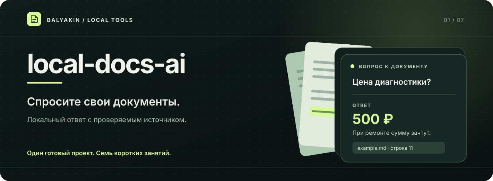

<div align="center">



<br>

<a href="#быстрый-запуск"></a>
<a href="docs/ollama.md"></a>
<a href="lessons/01-start.md"></a>

<p>Локальный ИИ для ваших документов · готовое приложение и маршрут из семи занятий<br>
Автор: <a href="https://github.com/balyakin">@balyakin</a> · проект: <a href="https://github.com/balyakin/local-docs-ai">balyakin/local-docs-ai</a></p>

</div>

# local-docs-ai

Где в заметках написано, когда забрать заказ? Можно открыть десять файлов и искать глазами. А можно спросить папку. Этот проект делает второе: ищет подходящие куски текста, отдаёт их локальной языковой модели и показывает, откуда взялся ответ.

Здесь есть готовое приложение **и** маршрут из семи занятий. Сначала запустите пример. Потом разберите его по частям и замените вымышленную веломастерскую своими заметками. Для поиска и ответа приложение использует модели Ollama.

## Что получится

```text
documents/*.md, *.txt → фрагменты → embeddinggemma → data/index.json
вопрос → embeddinggemma → подходящие фрагменты → qwen3:1.7b → ответ + строки источников
```

Работает на вашем компьютере. Код отправляет текст документов на локальный адрес Ollama `127.0.0.1:11434`; платный API и аккаунт не нужны. Первую загрузку самих моделей Ollama делает через интернет. После ответа можно открыть найденные фрагменты и проверить модель: она ошибается.

## Быстрый запуск

Нужны Python 3.10 или новее и установленная Ollama. [Пошаговая установка Ollama для Windows, macOS и Linux](docs/ollama.md) занимает отдельную страницу; начните с неё, если Ollama пока нет.

В терминале из этой папки:

```bash
ollama pull embeddinggemma
ollama pull qwen3:1.7b
python docqa.py doctor
python docqa.py index
python docqa.py ask "Сколько стоит диагностика?"
```

Если команда `python` не найдена, попробуйте `python3` (macOS/Linux) или `py` (Windows). Команда `doctor` проверяет, отвечает ли Ollama и скачаны ли обе модели. Она скажет, чего именно не хватает.

Для окна в браузере поставьте единственную зависимость приложения:

```bash
python -m venv .venv
```

Активируйте окружение: на macOS/Linux — `source .venv/bin/activate`, в PowerShell — `.venv\Scripts\Activate.ps1`. Затем:

```bash
python -m pip install -r requirements.txt
python -m streamlit run app.py
```

Откроется локальная страница. Кнопка «Обновить индекс» нужна после любого изменения файлов в `documents/`. Тестовый [документ о веломастерской](documents/example.md) уже лежит там, поэтому первый вопрос можно задать сразу.

## Свои документы

Положите в `documents/` файлы `.md` или `.txt` в кодировке UTF-8. Подпапки разрешены. До 50 файлов и до 1 МБ текста в сумме — это небольшой личный архив, а не хранилище компании. PDF пока не читается. Остальные форматы пропускаются.

Индекс хранится в `data/index.json`: там есть текстовые фрагменты и их векторы. Папка `data/` и ваши файлы в `documents/` исключены из Git; пример остаётся в репозитории. Если документы изменились, приложение попросит пересобрать индекс, чтобы старый ответ не выдавался за свежий.

## Учебный маршрут

Предполагается, что вы уже знаете основы Python: переменные, функции, списки и словари. Дальше пойдём по одной программе, без скачков между несвязанными демо.

1. [Запуск и первая проверка Ollama](lessons/01-start.md)
2. [Из файла в фрагменты с номерами строк](lessons/02-documents.md)
3. [Векторы и локальный индекс](lessons/03-index.md)
4. [Поиск подходящего фрагмента](lessons/04-search.md)
5. [Ответ модели и источники](lessons/05-answer.md)
6. [Приложение в браузере](lessons/06-browser.md)
7. [Проверка на чужих вопросах](lessons/07-evaluation.md)

Каждая глава заканчивается маленькой проверкой. Готовый код лежит рядом, в `docqa.py` и `app.py`: можно сначала разобраться в нём, затем повторить опыт в своей копии. [Набор контрольных вопросов](eval/questions.md) пригодится в конце.

## Если что-то сломалось

- `Ollama не отвечает` — откройте приложение Ollama; на Linux проверьте `ollama serve`. Затем повторите `python docqa.py doctor`.
- `Не найдены модели` — выполните команды `ollama pull`, которые показал `doctor`.
- `Документы изменились` — снова нажмите «Обновить индекс» или выполните `python docqa.py index`.
- `Индекс повреждён` — пересоберите его. Исходные файлы в `documents/` приложение не меняет.
- Ответ выглядит убедительно, но неверен — посмотрите фрагменты под ним. Если в них нет нужного факта, модель могла его додумать.

Проверки кода запускаются без Ollama и без Streamlit:

```bash
python -m unittest discover -s tests -v
```

Перед публикацией на GitHub добавьте в этой папке свой remote и выберите лицензию проекта.
